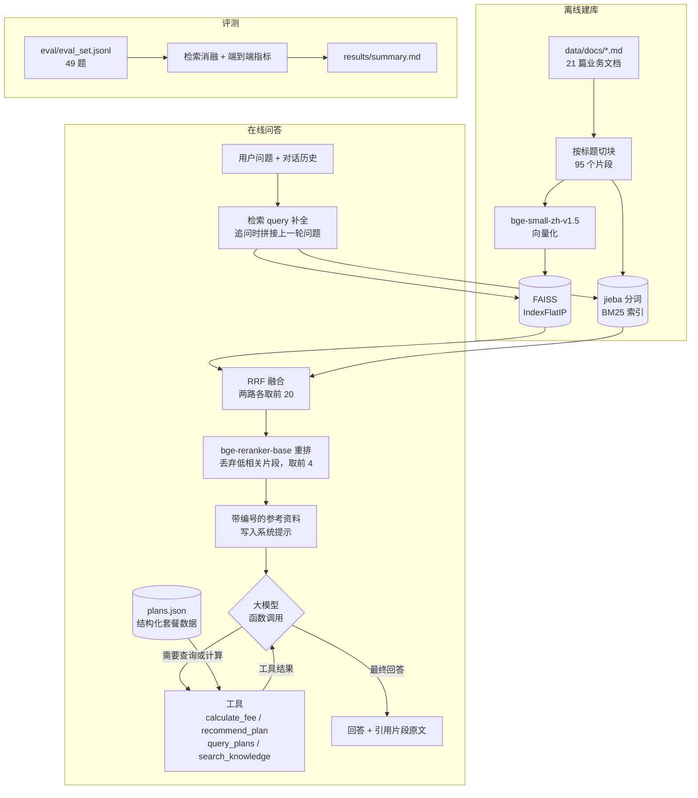

# 历史实现与实验说明

以下保留本轮整理前的说明与实验记录。历史结果不代表2026年10月24日重新执行；本轮验证见 docs/verification/20261024/。

# 中文运营商客服问答助手（RAG + 智能体）

面向运营商客服场景的问答助手：混合检索（向量 + BM25）+ 重排 + 带引用的生成；智能体通过函数调用自主决定何时查套餐、算费用；支持多轮对话。项目附带 49 题评测集和自动评测脚本，结果写入 `results/`。

> **声明**：知识库是作者自行编写的演示资料，运营商“青禾通信”及其套餐、价格、规则都是**虚构**的，不代表中国联通或任何真实运营商的资费。详见 [data/SOURCES.md](data/SOURCES.md)。

## 效果一览

在自建的 49 题评测集上（本地 RTX 4070 Ti 运行 Qwen3-4B-Instruct-2507）：

| 配置 | 答案准确率 | 引用正确率 | 工具调用正确率 | 无依据回答比例 | 知识库外问题拒答率 |
| --- | --- | --- | --- | --- | --- |
| 离线规则基线（不用大模型） | 79.6% | 94.1% | 100% | 6.1% | 50.0% |
| Qwen3-4B，关闭重排 | 95.9% | 94.1% | 100% | 0.0% | 100% |
| **Qwen3-4B，完整流程** | **98.0%** | **100%** | **100%** | **2.0%** | **100%** |

指标定义、检索消融和错误分析见[评测](#评测)。评测集小，而且和知识库出自同一作者，数字偏乐观，局限见[问题与改进](#问题与改进)。

## 架构



一轮问答的流程：

1. **检索 query 补全**：追问（如“那毕业以后会怎么样？”）很短或带指代词时，拼上上一轮的问题再检索。
2. **混合检索 + 重排**：向量检索擅长同义改写（“号码被收回”≈“销号”），BM25 擅长精确词（“LOS 灯”“59 元”）。两路用 RRF 融合后交给交叉编码器重排，低于阈值的片段丢弃。
3. **检索前置 + 工具按需调用**：参考资料先写进系统提示，模型再决定直接回答，还是调用工具查套餐、算费用、补充检索，最多 4 轮。
4. **引用回溯**：模型只输出 `[n]` 编号，程序把编号映射回原文片段一并展示，无效编号会被丢弃。

## 快速开始

需要 Python 3.10–3.13（在 3.13 上测试过）。

```bash
python -m venv .venv
.venv\Scripts\activate            # macOS / Linux: source .venv/bin/activate
pip install -r requirements.txt
```

**一条命令跑通**（建索引 → 演示问答 → 检索消融 → 端到端评测，结果写入 `results/`）：

```bash
python run.py
```

- 不做任何配置时使用**离线规则基线**，不需要 API Key 和 GPU。在一台只装了 CPU 版 PyTorch 的新环境里实测可以跑通，结果和上表第一行一致。
- 第一次运行会从 HuggingFace 下载 bge-small-zh-v1.5（约 100MB）和 bge-reranker-base（约 1.1GB）。在国内下载慢时先设置镜像：`HF_ENDPOINT=https://hf-mirror.com`（可以写进 `.env`）。

其他命令：

```bash
python run.py chat                       # 多轮对话（/reset 清空上下文，/exit 退出）
python run.py ask "停机保号每个月多少钱？"   # 单轮问答
python run.py eval --limit 10            # 只评前 10 题
python run.py eval --retrieval-only      # 只做检索消融
python run.py index --rebuild            # 重建索引（改了 data/docs 后会自动重建）
pytest                                   # 38 个单元测试，不需要下载模型
```

**网页演示**（Gradio）：

```bash
python run.py web                        # 浏览器打开终端打印的地址，默认 http://127.0.0.1:7860，可用 --port 指定
```

- 左边是多轮对话；右边是最近一轮回答的详情：引用片段原文（文档标题、小节、重排相关度）、工具调用的参数和返回结果、耗时，追问时还会显示拼接后的检索 query。
- 示例问题和 `python run.py` 的演示问答相同，点击直接发送；每组示例开启新对话，多轮追问按 ①→② 的顺序点。“清空对话”会同时清空模型看到的对话历史。
- 大模型后端同样由环境变量决定，页面顶部显示当前后端。离线基线（包括隐藏 GPU、只用 CPU）和 `LLM_PROVIDER=hf`（Qwen3-4B）都在浏览器里实测过多轮对话；OpenAI 兼容接口和 Claude 后端没有实测。离线基线只会抽取原句，追问经常答不好（评测里多轮题只对 1/4），演示时建议用大模型后端。
- 每个浏览器标签页是一段独立的对话，但所有提问排成一队、一次只回答一个，只适合本机演示，不能当多用户服务。

## 切换大模型

全部通过环境变量配置，代码里没有任何密钥。把 [.env.example](.env.example) 复制为 `.env` 后取消对应行的注释（`.env` 已加入 `.gitignore`）。

| 方式 | 配置 | 本机是否实测 |
| --- | --- | --- |
| 离线规则基线（默认） | 不配置，或 `LLM_PROVIDER=offline` | 已实测 |
| 本地 GPU + transformers | `LLM_PROVIDER=hf`，`LLM_MODEL=Qwen/Qwen3-4B-Instruct-2507` | 已实测（RTX 4070 Ti 12GB） |
| 国产大模型 API（DeepSeek、通义千问等，OpenAI 兼容接口） | `LLM_PROVIDER=openai`，`LLM_BASE_URL`，`LLM_MODEL`，`LLM_API_KEY` | 代码已实现，未用真实密钥测试 |
| 本地 Ollama 的 Qwen | `LLM_PROVIDER=openai`，`LLM_BASE_URL=http://localhost:11434/v1`，`LLM_MODEL=qwen2.5:7b` | 未测试（本机没有安装 Ollama） |
| Claude API | `LLM_PROVIDER=anthropic`，`LLM_MODEL=claude-opus-5-5`，`ANTHROPIC_API_KEY` | 代码已实现，未用真实密钥测试 |

本地 GPU 方式需要先装 CUDA 版 PyTorch，再装其余依赖：

```bash
pip install torch --index-url https://download.pytorch.org/whl/cu128
pip install -r requirements.txt
```

Qwen3-4B 以 bf16 加载约占 7.5GB 显存。`hf` 模式下，向量模型和重排模型会自动放到 CPU，把显存留给大模型（见[问题与改进](#问题与改进)第 6 条）。

## 评测

### 评测集（[eval/eval_set.jsonl](eval/eval_set.jsonl)）

| 类型 | 题数 | 说明 |
| --- | --- | --- |
| 知识问答 | 31 | 其中 8 题改写成口语问法，避开文档里的业务术语（如用“号码要用多久才能转到别的运营商”代替“携号转网的在网时长要求”） |
| 工具计算 | 8 | 套外流量封顶、副卡计费、按用量推荐、按预算筛选 |
| 多轮对话 | 4 | 第二轮依赖第一轮的上下文（如“那边的流量日租包多少钱一天？”） |
| 知识库外 | 6 | 卫星电话、物联网卡、座机等知识库没有的内容，正确做法是拒答 |

标注内容：

- 每题都有标准答案。
- 能回答的题标注了关键事实，每个事实允许多种写法。
- 34 道题标注了标准出处文档（知识问答和 3 道多轮题）。
- 需要工具的题标注了预期工具。

### 指标定义

- **答案准确率**：能回答的题，回答必须包含全部关键事实且没有拒答；知识库外的题，正确拒答才算对。
- **引用正确率**：有标准出处的题，回答引用的片段里至少有一个来自标准出处文档。另外统计引用精确率，即引用中来自标准出处的比例。
- **工具调用正确率**：需要工具的题，是否调用了预期的工具。
- **无依据回答比例**：满足任一条即算无依据：① 知识库外的题没有拒答；② 既没引用资料也没调用工具；③ 回答里带单位的数字（如“189元”“120天”）在给模型看过的资料、工具结果和问题里都找不到。

### 端到端结果

完整表格见 [results/summary.md](results/summary.md)，逐题明细见 `results/e2e_*.json`。

| 后端 | 题数 | 答案准确率 | 引用正确率 | 引用精确率 | 工具调用正确率 | 无依据回答比例 | 拒答正确率 | 误拒率 | 平均耗时 | 平均模型调用次数 |
| --- | --- | --- | --- | --- | --- | --- | --- | --- | --- | --- |
| hf:Qwen/Qwen3-4B-Instruct-2507 | 49 | 98.0% | 100.0% | 98.5% | 100.0% | 2.0% | 100.0% | 0.0% | 4.05s | 1.18 |
| hf:Qwen/Qwen3-4B-Instruct-2507（关闭重排） | 49 | 95.9% | 94.1% | 94.1% | 100.0% | 0.0% | 100.0% | 2.3% | 2.69s | 1.18 |
| offline:rule-based | 49 | 79.6% | 94.1% | 86.8% | 100.0% | 6.1% | 50.0% | 0.0% | 0.03s | 1.18 |

分题型答案准确率：

| 后端 | 知识问答 | 工具计算 | 多轮对话 | 知识库外 |
| --- | --- | --- | --- | --- |
| hf:Qwen/Qwen3-4B-Instruct-2507 | 96.8% (n=31) | 100.0% (n=8) | 100.0% (n=4) | 100.0% (n=6) |
| hf:Qwen/Qwen3-4B-Instruct-2507（关闭重排） | 93.5% (n=31) | 100.0% (n=8) | 100.0% (n=4) | 100.0% (n=6) |
| offline:rule-based | 87.1% (n=31) | 100.0% (n=8) | 25.0% (n=4) | 50.0% (n=6) |

测试环境：Windows 11，i7-13700KF，32GB 内存，RTX 4070 Ti 12GB，Python 3.13，PyTorch 2.11（CUDA 12.8）。

关于耗时和调用次数：
- 耗时包含检索和全部模型调用。
- `hf` 模式为了给大模型留显存，检索和重排放在 CPU 上，每题约占 1 秒；关闭重排后每题快约 1.3 秒。
- 离线基线的检索在 GPU 上；在只有 CPU 的新环境里，每题约 1~2 秒。
- 离线基线没有大模型，“模型调用次数”指规则策略的决策次数。

### 检索消融（34 道有标准出处的题，按文档统计命中）

| 检索方式 | Recall@1 | Recall@3 | Recall@5 | MRR |
| --- | --- | --- | --- | --- |
| 向量检索 | 91.2% | 100.0% | 100.0% | 0.956 |
| BM25 | 85.3% | 97.1% | 97.1% | 0.892 |
| 混合(RRF) | 91.2% | 97.1% | 100.0% | 0.947 |
| 混合+重排 | 88.2% | 100.0% | 100.0% | 0.936 |

### 结论

- **大模型带来的提升主要在多轮对话和拒答上**。离线基线只能抽取原句，多轮题只答对 1/4，知识库外的题只拒答了 3/6。Qwen3-4B 这两类全对。
- **工具题两种配置都是 100%**，因为套外流量取整、150 元封顶、副卡免费张数等计算都交给了确定性的 Python 函数，模型只负责识别意图、抽取参数（离线基线用正则做同样的事）。大模型的价值在于能理解措辞多变的问法，而这 8 道题的问法比较规整。
- **重排在端到端上有用**：关闭重排后，答案准确率从 98.0% 降到 95.9%，引用正确率从 100% 降到 94.1%。例如“一直没交话费的话，多久号码会被收回？”只靠混合检索时，前 4 个片段里没有“欠费停机”，模型只能拒答；重排后它排到了第一。
- **重排没有提高 Recall@1**（88.2% 对比向量检索的 91.2%）。在只有 95 个片段的小知识库上，bge-small 向量检索已经很强。重排的价值在于把相关片段稳定排进前几名（Recall@3 100%），并给出 0~1 的相关度分数。
- **重排分数不能单独用来拒答**：知识库外问题的最高重排分数可以到 0.953（“卫星电话怎么收费”匹配到了“漫游通话收费”），和正常问题有重叠。所以阈值只用来过滤明显不相关的片段（0.05），是否拒答主要由大模型按提示词判断。
- **唯一的错误**（kb21“交了话费半天了余额还没变，怎么办？”）：检索把“销户余额退还”排在第一，模型编出了“超过 30 分钟未到账”。无依据检测发现了这个资料里没有的数字。

## 项目结构

```text
telecom-rag-agent/
├── run.py                 # 入口：一条命令跑通 / chat / web / ask / eval / index
├── requirements.txt
├── .env.example           # 大模型配置模板（复制为 .env）
├── data/
│   ├── docs/              # 21 篇知识库文档（自编，虚构运营商）
│   ├── plans.json         # 结构化套餐数据，供工具使用
│   ├── userdict.txt       # jieba 自定义词典（携号转网、停机保号……）
│   └── SOURCES.md         # 数据来源说明
├── eval/eval_set.jsonl    # 49 条评测题
├── telecom_rag/
│   ├── config.py          # 读取环境变量
│   ├── documents.py       # 文档加载与切块（按标题切，表格拆分时保留表头）
│   ├── index.py           # bge 向量化 + FAISS 存取
│   ├── retriever.py       # BM25 + 向量 + RRF + 重排
│   ├── tools.py           # 4 个工具：套餐查询、费用计算、套餐推荐、知识库再检索
│   ├── llm.py             # 大模型后端：OpenAI 兼容接口 / Claude / transformers
│   ├── offline.py         # 离线规则基线
│   ├── prompts.py         # 系统提示词
│   ├── agent.py           # 智能体：工具循环、多轮记忆、引用回溯
│   ├── textutil.py        # 拒答识别、引用编号解析、数字抽取
│   ├── evaluate.py        # 评测指标与结果汇总
│   └── web.py             # 网页演示（Gradio）：多轮对话 + 引用片段、工具调用、耗时
├── tests/                 # 单元测试（用假检索器和假模型测智能体循环和网页演示的处理逻辑）
└── results/               # 评测结果，summary.md 是汇总表
```

## 关键设计

- **为什么检索前置，而不是全交给模型决定要不要检索**：小模型有时不调用检索就直接作答，容易编造。先检索再生成，保证每个回答都有资料可依；同时保留 `search_knowledge` 工具，资料不够时模型可以换关键词再检索。
- **为什么费用计算交给工具**：“套外流量按 GB 向上取整、每月封顶 150 元、159 元套餐前 2 张副卡免费”这类多步规则，小模型心算很容易错。工具做确定性计算，返回带计算过程的 JSON，模型负责转述。
- **引用的可信度**：模型只写编号，原文由程序回填，模型无法伪造引用内容；评测再检查引用的文档是不是标准出处。
- **多后端统一接口**：内部使用一种消息格式，各后端负责转换成自己的工具调用格式（OpenAI 的 `tools`、Claude 的 `tool_use`/`tool_result`、Qwen 对话模板里的 `<tool_call>`），智能体代码与厂商解耦。离线基线也实现了同一个接口，所以它和大模型走的是完全相同的智能体循环。
- **离线基线的作用**：没有 API Key 和 GPU 的环境也能一条命令跑通全流程；同时作为对照组，量化大模型带来的提升。

## 问题与改进

1. **评测集小且同源**：49 道题由作者对着知识库编写，问法偏规整（只有 8 道题改成了口语问法）。98% 的准确率不代表真实线上效果。改进：收集真实用户问法，扩充到几百题，并划分开发集和测试集。
2. **判分规则比较宽松**：答案准确率靠关键事实字符串匹配，发现不了措辞上的错误。例如 tool08 合计 279 元正确，但模型把“第 3 张副卡收 10 元”转述成了“3 张副卡每月费用 10 元”。另外，同义说法没列全时会误判（评测时发现“96110”一题只接受“反诈”，不接受“诈骗”，已补上）。无依据检测只检查带单位的数字，不检查文字陈述；关闭重排时 kb21 引用了资料里真实存在的“15 分钟延迟”，但用错了场景，这类错误也查不出来。改进：加入大模型评审（LLM-as-judge）和人工抽检，用 NLI 模型做句子级事实一致性检查。
3. **参数是在同一评测集上观察后设定的**：重排过滤阈值 0.05、离线基线的拒答阈值 0.5，都参考了评测集上的分数分布，有过拟合风险。
4. **拒答主要依赖提示词**：重排分数对知识库外问题区分度不够（见评测结论），换一种问法可能就不拒答了。改进：试用 bge-reranker-v2-m3，或单独训练一个“能否回答”的分类器。
5. **多轮检索补全是规则**：“短问题或带指代词就拼接上一轮”，复杂的指代会失败。改进：让大模型先把追问改写成完整问题（查询改写）。
6. **12GB 显卡上的显存问题（已解决，记录排查过程）**：
   - 现象：本地 Qwen 评测时，工具题耗时从正常的约 8 秒变成 40~190 秒，同时进程占用的内存从约 3GB 涨到 5~6.6GB。
   - 原因：模型权重 7.5GB，加上重排模型、CUDA 上下文和其他程序，已经接近 12GB 上限；每次生成的序列长度不同，PyTorch 缓存的显存还会越积越多（实测从 8.5GB 涨到 10.1GB）。到达上限后，Windows 驱动会把显存溢出到内存继续运行，速度大幅下降。另外，`device_map="auto"` 在显存不够时会把部分层放到 CPU，同样不报错，只是变慢。
   - 解决：模型整体固定放在 GPU 上（显存不够时直接报错，而不是悄悄变慢）；`hf` 模式下把检索模型放到 CPU；每次生成后调用 `torch.cuda.empty_cache()`。之后显存稳定在约 10GB，工具题回到 6~10 秒。
7. **只实测了本地 Qwen3-4B**：国产大模型 API 和 Claude 的代码已实现，但没有用真实密钥跑过评测。
8. **工程上还缺**：流式输出、对话持久化、多用户并发（网页演示一次只回答一个问题）；接入真实资料时，还要处理 PDF 和网页解析、资费版本更新、过期资料下线。
